# FinTrack — Database Design & Java Persistence Architecture Specification

> **Target Database**: MySQL 8.x (InnoDB, `utf8mb4_0900_ai_ci`)  
> **Backend Framework**: Java 21, Spring Boot 3.x, Spring Data JPA, Hibernate 6.x  
> **Currency System**: Indian Rupee (`INR` / `₹`), `DECIMAL(15, 2)` / `BigDecimal(scale=2)`  
> **Migration Engine**: Flyway  

---

## 1. Entity Relationship Diagram (Mermaid ER)

```mermaid
erDiagram
    users ||--o{ monthly_plans : "creates"
    users ||--o{ expense_categories : "owns (custom)"
    users ||--o{ transactions : "records"
    users ||--o{ savings_goals : "tracks"
    users ||--o{ chatbot_conversations : "starts"

    monthly_plans ||--|{ budget_categories : "allocates"
    expense_categories ||--o{ budget_categories : "budgeted_in"
    expense_categories ||--o{ transactions : "categorizes"

    savings_goals ||--o{ savings_contributions : "funded_by"
    chatbot_conversations ||--o{ chatbot_messages : "contains"

    users {
        bigint id PK "AUTO_INCREMENT"
        varchar(100) full_name "NOT NULL"
        varchar(150) email UK "NOT NULL, UNIQUE"
        varchar(255) password_hash "NOT NULL, BCrypt/Argon2"
        varchar(20) account_status "NOT NULL, ACTIVE/SUSPENDED/DELETED"
        timestamp created_at "NOT NULL, DEFAULT CURRENT_TIMESTAMP"
        timestamp updated_at "NOT NULL, DEFAULT CURRENT_TIMESTAMP ON UPDATE"
    }

    expense_categories {
        bigint id PK "AUTO_INCREMENT"
        bigint user_id FK "NULL for system, user_id for custom"
        varchar(80) name "NOT NULL"
        varchar(10) category_type "NOT NULL, INCOME or EXPENSE"
        boolean is_system "NOT NULL, DEFAULT FALSE"
        timestamp created_at "NOT NULL, DEFAULT CURRENT_TIMESTAMP"
        timestamp updated_at "NOT NULL, DEFAULT CURRENT_TIMESTAMP ON UPDATE"
    }

    monthly_plans {
        bigint id PK "AUTO_INCREMENT"
        bigint user_id FK "NOT NULL"
        date plan_month "NOT NULL, YYYY-MM-01 normalized"
        decimal(15_2) expected_income "NOT NULL, >= 0.00 (INR)"
        decimal(15_2) target_savings "NOT NULL, >= 0.00 (INR)"
        char(3) currency_code "NOT NULL, DEFAULT 'INR'"
        varchar(500) notes "Optional"
        timestamp created_at "NOT NULL, DEFAULT CURRENT_TIMESTAMP"
        timestamp updated_at "NOT NULL, DEFAULT CURRENT_TIMESTAMP ON UPDATE"
    }

    budget_categories {
        bigint id PK "AUTO_INCREMENT"
        bigint monthly_plan_id FK "NOT NULL"
        bigint category_id FK "NOT NULL"
        decimal(15_2) planned_amount "NOT NULL, >= 0.00 (INR)"
        timestamp created_at "NOT NULL, DEFAULT CURRENT_TIMESTAMP"
        timestamp updated_at "NOT NULL, DEFAULT CURRENT_TIMESTAMP ON UPDATE"
    }

    transactions {
        bigint id PK "AUTO_INCREMENT"
        bigint user_id FK "NOT NULL"
        bigint category_id FK "NOT NULL"
        varchar(10) transaction_type "NOT NULL, INCOME or EXPENSE"
        decimal(15_2) amount "NOT NULL, > 0.00 (INR)"
        varchar(255) description "NOT NULL"
        date transaction_date "NOT NULL"
        varchar(20) payment_method "NOT NULL, UPI/CASH/CARDS/NETBANKING"
        text notes "Optional"
        timestamp created_at "NOT NULL, DEFAULT CURRENT_TIMESTAMP"
        timestamp updated_at "NOT NULL, DEFAULT CURRENT_TIMESTAMP ON UPDATE"
    }

    savings_goals {
        bigint id PK "AUTO_INCREMENT"
        bigint user_id FK "NOT NULL"
        varchar(120) name "NOT NULL"
        decimal(15_2) target_amount "NOT NULL, > 0.00 (INR)"
        decimal(15_2) current_amount "NOT NULL, >= 0.00 (INR)"
        date target_date "Optional deadline"
        varchar(20) status "NOT NULL, ACTIVE/COMPLETED/PAUSED/CANCELLED"
        timestamp created_at "NOT NULL, DEFAULT CURRENT_TIMESTAMP"
        timestamp updated_at "NOT NULL, DEFAULT CURRENT_TIMESTAMP ON UPDATE"
    }

    savings_contributions {
        bigint id PK "AUTO_INCREMENT"
        bigint savings_goal_id FK "NOT NULL"
        decimal(15_2) amount "NOT NULL, > 0.00 (INR)"
        date contribution_date "NOT NULL"
        varchar(255) description "Optional note"
        timestamp created_at "NOT NULL, DEFAULT CURRENT_TIMESTAMP"
    }

    chatbot_conversations {
        bigint id PK "AUTO_INCREMENT"
        bigint user_id FK "NOT NULL"
        varchar(150) title "NOT NULL"
        timestamp created_at "NOT NULL, DEFAULT CURRENT_TIMESTAMP"
        timestamp updated_at "NOT NULL, DEFAULT CURRENT_TIMESTAMP ON UPDATE"
    }

    chatbot_messages {
        bigint id PK "AUTO_INCREMENT"
        bigint conversation_id FK "NOT NULL"
        varchar(15) role "NOT NULL, USER/ASSISTANT/SYSTEM"
        text content "NOT NULL"
        json metadata_json "Optional token usage or suggestions"
        timestamp created_at "NOT NULL, DEFAULT CURRENT_TIMESTAMP"
    }
```



---

## 2. Table Catalog & Design Rationale

### A. `users`
- **Purpose**: Authenticated user identity in FinTrack.
- **Constraints**:
  - `uk_users_email`: Enforces email uniqueness across the entire system.
  - `chk_users_account_status`: Restricts values to `ACTIVE`, `SUSPENDED`, `DELETED`.
- **Security Guardrail**: Plaintext passwords, banking tokens, NetBanking credentials, UPI PINs, and SMS OTPs are **strictly banned** from this schema. Passwords must be hashed using BCrypt (`$2a$10$...`) or Argon2 before hitting the database.

### B. `expense_categories`
- **Purpose**: Universal classification taxonomy for income streams and expense categories.
- **System vs. Custom**:
  - **System Categories (`is_system = TRUE`, `user_id = NULL`)**: Shared by all users. Seeded via Flyway `V2__seed_system_categories.sql` (e.g., *House Rent*, *Food and Groceries*, *Transport and Petrol*, *Bills and Utilities*, *Salary*, *Freelance Income*).
  - **Custom User Categories (`is_system = FALSE`, `user_id = <id>`)**: Created by individual users for specialized personal tracking (e.g., *Mutual Fund SIP*, *Gold Purchase*).
- **Uniqueness Constraint**: Unique index `(COALESCE(user_id, 0), category_type, name)` prevents duplicate names within the same ownership scope.

### C. `monthly_plans`
- **Purpose**: Financial master plan for a single calendar month.
- **`plan_month` Column**: Standardized to `DATE` pointing to the 1st of the month (`YYYY-MM-01`).
- **Constraint**: `UNIQUE KEY uk_monthly_plan_user_month (user_id, plan_month)` guarantees at the database level that a user cannot create conflicting duplicate plans for October 2026.
- **Checks**: Both `expected_income` and `target_savings` have `CHECK (col >= 0.00)` in Indian Rupees.

### D. `budget_categories`
- **Purpose**: Connects a `monthly_plan` to specific expense categories with a planned spending cap.
- **Constraint**: `UNIQUE KEY uk_budget_plan_category (monthly_plan_id, category_id)` ensures an expense category is budgeted at most once in a given month.
- **Deletion Rule**: `ON DELETE CASCADE` from `monthly_plans`. If a user deletes an entire draft monthly plan, its associated category budget lines are cleaned up cleanly.

### E. `transactions`
- **Purpose**: Real manual financial cash flows in Indian Rupees (INR).
- **Amounts Design**: Positive numbers strictly enforced via `CHECK (amount > 0.00)`. Cash flow direction is exclusively determined by `transaction_type` (`INCOME` or `EXPENSE`). This design prevents negative arithmetic bugs, clarifies reporting queries, and aligns with accounting ledger standards.
- **Payment Method**: Label classification tag (`UPI`, `CASH`, `DEBIT_CARD`, `CREDIT_CARD`, `BANK_TRANSFER`, `OTHER`). **No real payment gateway processing or bank integration occurs.**
- **Indexes**:
  - `idx_tx_user_date (user_id, transaction_date DESC)`: High performance dashboard query for recent transactions.
  - `idx_tx_user_type_date (user_id, transaction_type, transaction_date)`: Super-fast monthly income and expense sum queries.
  - `idx_tx_user_cat_date (user_id, category_id, transaction_date)`: Instant category breakdown reporting.

### F. `savings_goals` & `savings_contributions`
- **Purpose**: Long-term milestone tracking (Emergency Fund, Wedding, House Down Payment).
- **Aggregate Maintenance**: `current_amount` on `savings_goals` represents the running aggregate. When a contribution is inserted in `savings_contributions`, the backend service transactionally updates `current_amount` using optimistic locking or an atomic increment.
- **Crucial FinTrack Accounting Rule**: Goal contributions are milestone trackings. They **must never be treated as regular expenses** or double-subtracted from the user's monthly actual savings calculation!

### G. `chatbot_conversations` & `chatbot_messages`
- **Purpose**: Dedicated on-demand AI financial advisor history (powered by Gemini or localized assistant).
- **Separation**: Kept completely isolated from transactional tables. Chat history can be truncated or deleted by the user without compromising financial ledgers.
- **Security**: No prompt injection API keys or bearer tokens are stored in the database.

---

## 3. Core Business Rules & Accounting Equations

| # | Business Rule | Enforcement Mechanism |
|---|---|---|
| **1** | User Scoping & Isolation | Every query must filter `WHERE user_id = :userId`. Cross-user access is impossible. |
| **2** | Positive Transaction Amounts | Database constraint `CHECK (amount > 0.00)` + Jakarta `@DecimalMin("0.01")`. |
| **3** | Non-negative Budget Targets | `CHECK (expected_income >= 0.00)`, `CHECK (target_savings >= 0.00)`, `CHECK (planned_amount >= 0.00)`. |
| **4** | One Plan Per Month Per User | `UNIQUE KEY (user_id, plan_month)` on `monthly_plans`. |
| **5** | No Duplicate Budget Category | `UNIQUE KEY (monthly_plan_id, category_id)` on `budget_categories`. |
| **6** | Positive Goal Contributions | `CHECK (amount > 0.00)` on `savings_contributions`. |
| **7** | Actual Savings Equation | $\text{Actual Savings} = \sum \text{Recorded Income} - \sum \text{Recorded Expenses}$. |
| **8** | Planned Savings Independence | Planned savings is a target intent; it is never counted as real savings until money is earned and unspent. |
| **9** | Goal Contributions Independence | Goal contributions are tracked transfers; do not subtract contributions a second time from actual savings. |
| **10** | Referential Integrity Safety | `ON DELETE RESTRICT` on `fk_transactions_category` and `fk_transactions_user` prevents accidental data loss. |

---

## 4. Analytical Reporting Queries (MySQL 8.x)

### Query 1: Monthly Income Total
```sql
SELECT COALESCE(SUM(amount), 0.00) AS total_monthly_income
FROM transactions
WHERE user_id = :userId
  AND transaction_type = 'INCOME'
  AND transaction_date BETWEEN :startDate AND :endDate;
```

### Query 2: Monthly Expense Total
```sql
SELECT COALESCE(SUM(amount), 0.00) AS total_monthly_expense
FROM transactions
WHERE user_id = :userId
  AND transaction_type = 'EXPENSE'
  AND transaction_date BETWEEN :startDate AND :endDate;
```

### Query 3: Net Actual Savings
```sql
SELECT 
    COALESCE(SUM(CASE WHEN transaction_type = 'INCOME' THEN amount ELSE 0.00 END), 0.00) -
    COALESCE(SUM(CASE WHEN transaction_type = 'EXPENSE' THEN amount ELSE 0.00 END), 0.00) AS actual_savings
FROM transactions
WHERE user_id = :userId
  AND transaction_date BETWEEN :startDate AND :endDate;
```

### Query 4: Category-Wise Actual Expense Breakdown
```sql
SELECT 
    c.id AS category_id,
    c.name AS category_name,
    COALESCE(SUM(t.amount), 0.00) AS total_spent,
    COUNT(t.id) AS transaction_count,
    ROUND((SUM(t.amount) * 100.0 / total.sum_expense), 2) AS percentage_of_total
FROM transactions t
JOIN expense_categories c ON t.category_id = c.id
CROSS JOIN (
    SELECT COALESCE(SUM(amount), 1.00) AS sum_expense 
    FROM transactions 
    WHERE user_id = :userId AND transaction_type = 'EXPENSE' 
      AND transaction_date BETWEEN :startDate AND :endDate
) total
WHERE t.user_id = :userId
  AND t.transaction_type = 'EXPENSE'
  AND t.transaction_date BETWEEN :startDate AND :endDate
GROUP BY c.id, c.name, total.sum_expense
ORDER BY total_spent DESC;
```

### Query 5: Planned vs. Actual Spending by Category
```sql
SELECT 
    c.id AS category_id,
    c.name AS category_name,
    bc.planned_amount,
    COALESCE(actual.total_spent, 0.00) AS actual_spent,
    (bc.planned_amount - COALESCE(actual.total_spent, 0.00)) AS remaining_budget,
    CASE 
        WHEN bc.planned_amount > 0 THEN 
            ROUND((COALESCE(actual.total_spent, 0.00) * 100.0 / bc.planned_amount), 2)
        ELSE 0.00 
    END AS budget_utilization_pct
FROM monthly_plans mp
JOIN budget_categories bc ON mp.id = bc.monthly_plan_id
JOIN expense_categories c ON bc.category_id = c.id
LEFT JOIN (
    SELECT category_id, SUM(amount) AS total_spent
    FROM transactions
    WHERE user_id = :userId 
      AND transaction_type = 'EXPENSE'
      AND transaction_date BETWEEN :startDate AND :endDate
    GROUP BY category_id
) actual ON c.id = actual.category_id
WHERE mp.user_id = :userId
  AND mp.plan_month = :planMonth
ORDER BY actual_spent DESC;
```

### Query 6: Savings Goal Progress
```sql
SELECT 
    g.id AS goal_id,
    g.name AS goal_name,
    g.target_amount,
    g.current_amount,
    (g.target_amount - g.current_amount) AS pending_amount,
    ROUND((g.current_amount * 100.0 / g.target_amount), 2) AS progress_pct,
    g.target_date,
    g.status,
    COUNT(c.id) AS total_contributions
FROM savings_goals g
LEFT JOIN savings_contributions c ON g.id = c.savings_goal_id
WHERE g.user_id = :userId
GROUP BY g.id, g.name, g.target_amount, g.current_amount, g.target_date, g.status
ORDER BY g.created_at DESC;
```
